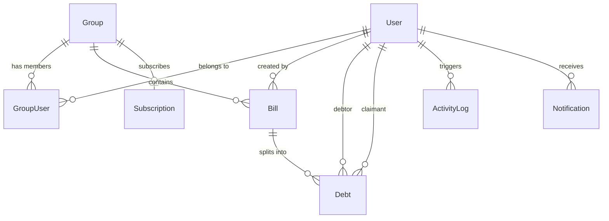

# 🧾 BillMate API (Backend)

[](https://dotnet.microsoft.com/)
[](https://docs.microsoft.com/ef/core/)
[](https://www.mysql.com/)
[](https://dotnet.microsoft.com/apps/aspnet/signalr)
[](https://opensource.org/licenses/MIT)

> **BillMate** is a scalable, cloud-ready RESTful Web API engineered with **ASP.NET Core (.NET 8)** and **Entity Framework Core**. It is designed to handle group expense management, smart bill splitting, automated debt calculation, real-time activity notifications, and multi-tier subscription billing (integrating **Google Play Billing** & **Shopier Payment Gateway**).

---

## 🌟 Key Highlights & Features

- **👥 Group & Member Management:** Create groups, generate join codes/QR codes, invite members, and calculate aggregated balances.
- **💸 Intelligent Bill Splitting & Settlements:** 
  - Dynamic bill creation with multi-user debt allocations.
  - Settle debts between claimants and debtors with automatic balance recalculation.
  - Receipt and invoice attachment processing.
- **🔐 Secure Authentication & Identity:**
  - ASP.NET Core Identity with role-based authorization (`Admin`, `User`).
  - JWT (JSON Web Tokens) with secure cookie & header verification.
  - MailerSend transactional email integration for email confirmation & password resets.
- **💳 Multi-Platform Subscription & Payments:**
  - In-app purchases via **Google Play Developer API (Android Publisher v3)** for recurring mobile subscriptions.
  - Hosted checkout forms and webhook signature verification using **Shopier**.
  - Trial period support & quota management per group based on subscribed tier.
- **⚡ Real-Time Notifications (SignalR):**
  - Instant live alerts for new bills, settlement requests, and group activities via WebSockets.
- **🔄 Background Workers:**
  - Hosted services (`IHostedService`) for periodic subscription validation and renewal verification.

---

## 🏗️ Architecture & Clean Design

The solution follows clean architectural separation:

```
BillMate/
├── Controllers/       # RESTful API controllers with HTTP attribute routing
├── DTOs/              # Strongly-typed Data Transfer Objects & validation schemas
├── Data/              # Entity Framework DbContext, fluent configurations & relationships
├── Hubs/              # SignalR real-time hubs for push notifications
├── Interfaces/        # Service contracts & dependency injection abstractions
├── Middleware/        # JWT validation, error handling, seeders & security
├── Migrations/        # EF Core database migrations snapshot
├── Models/            # Domain entities (User, Bill, Group, Debt, Subscription, ActivityLog)
└── Services/          # Encapsulated business logic implementations
```

---

## 🗄️ Domain Entity Relationship



---

## 🛠️ Tech Stack & Dependencies

| Layer / Concern | Technology |
|---|---|
| **Framework** | ASP.NET Core 8.0 (C# 12) |
| **ORM / Data Access** | Entity Framework Core 8.0, Pomelo / MySQL Connector |
| **Authentication** | ASP.NET Core Identity, JWT Bearer (`System.IdentityModel.Tokens.Jwt`) |
| **Real-time** | ASP.NET Core SignalR |
| **Email Service** | MailerSend REST API integration |
| **Payment Integrations** | Google Play Android Publisher API v3, Shopier Payment Gateway (HMAC-SHA256) |
| **Containerization** | Docker multi-stage build |

---

## 🚀 Getting Started (Local Development)

### Prerequisites

- [.NET 8.0 SDK](https://dotnet.microsoft.com/download/dotnet/8.0)
- [MySQL 8.0+](https://dev.mysql.com/downloads/) or Docker
- [Git](https://git-scm.com/)

### 1. Clone the Repository

```bash
git clone https://github.com/Husam-Abdulraheem/BillMate-Backend.git
cd BillMate-Backend
```

### 2. Configure Environment Variables

Create a `.env` file in the `BillMate` project directory using the provided template:

```bash
cp .env.example BillMate/.env
```

Adjust the values in `BillMate/.env`:

```env
ASPNETCORE_ENVIRONMENT=Development
DATABASE_URL="Server=localhost;Port=3306;Database=billmate_db;User=root;Password=your_password;"
JWT_SECRET="YourSuperSecretLongKeyForJwtSigningAtLeast32Chars!"
JWT_ISSUER="https://localhost:3000"
JWT_AUDIENCE="https://localhost:5173"
JWT_EXPIRY=2
```

### 3. Apply Migrations & Run Database Update

```bash
cd BillMate
dotnet ef database update
```

### 4. Build and Run the API

```bash
dotnet run
```

The API will start locally at `http://localhost:3000` (or the port defined in `launchSettings.json`).

---

## 🐳 Docker Support

You can build and run the API container with Docker:

```bash
# Build the Docker image
docker build -t billmate-backend -f BillMate/Dockerfile BillMate

# Run container
docker run -d -p 3000:3000 --env-file BillMate/.env --name billmate-api billmate-backend
```

---

## 📄 License

This project is licensed under the [MIT License](LICENSE).
